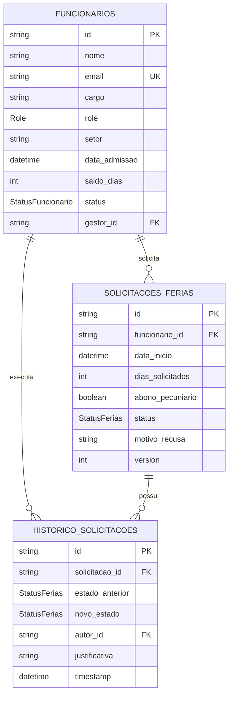
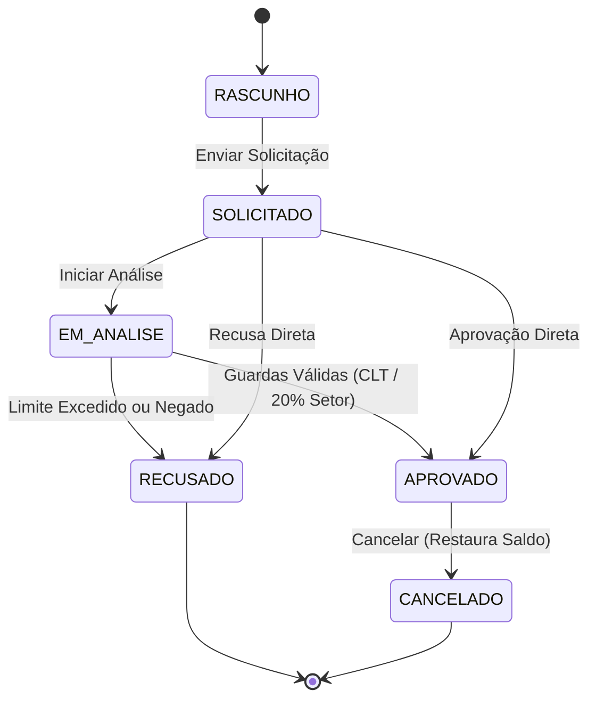

# Sistema de Gestão de Férias (Tema 17)

Plataforma corporativa de RH desenvolvida com NestJS/Prisma (Backend) e Next.js/TailwindCSS (Frontend).

## 📊 Diagrama Entidade-Relacionamento (DER)



## 🔄 Diagrama de Estados (Máquina de Estados)



## 🚀 Como Executar o Ambiente Locally

### Backend (NestJS)
```bash
cd ppw_server
npm install
npx prisma generate
npm run start:dev
```

### Frontend (Next.js)
```bash
cd ppw_client
npm install
npm run dev
```
